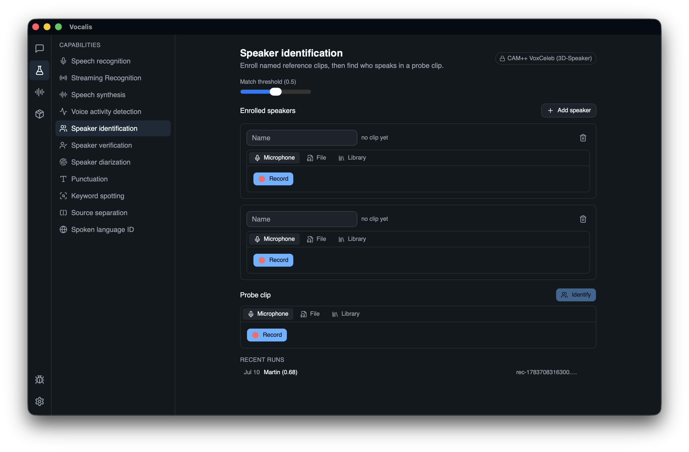

# Vocalis

A local-first, realtime speech app for macOS — speech-to-text, text-to-speech, and voice cloning, powered by [sherpa-onnx](https://github.com/k2-fsa/sherpa-onnx) running in-process in Rust.



Vocalis is three things at once:

1. **A daily driver** — system-wide push-to-talk dictation into any app, live meeting transcription with speaker names, and hands-free voice conversations with an LLM that answers in a voice you chose, including a clone of your own.
2. **A speech lab** — a Playground exposing all ten sherpa-onnx capabilities (recognition, synthesis, VAD, speaker ID/verification/diarization, punctuation, keyword spotting, source separation, language ID) with full parameter surfaces and engine comparison.
3. **A hybrid inference host** — every speech task can run fully on-device or via cloud APIs (OpenAI, ElevenLabs, Groq, Deepgram), chosen per task with a global privacy mode that hard-disables all network inference.

## Design principles

- **Local-first, privacy by default** — everything lives under `~/.vocalis/`, API keys live in the macOS keychain, mic audio is ephemeral unless you opt to keep it, and one switch makes the app provably offline.
- **Hybrid by choice, never by magic** — the app never silently routes audio to a cloud API; the active engine is always visible and overridable in place.
- **One inference stack** — sherpa-onnx serves all local capabilities including voice cloning (ZipVoice); no Python sidecars, no second runtime.
- **VAD-gated batch, not streaming partials** — chat, live sessions, and dictation buffer each VAD-bounded utterance and run one batch decode on the falling edge, keeping turn-taking VAD-driven rather than decode-driven.

See [`spec/spec.md`](spec/spec.md) for the full product and technical spec, and [`spec/current_plan.md`](spec/current_plan.md) for current build status.

## Features

- **Chat** — LLM voice conversations (mic → VAD → batch STT → streaming LLM reply via [pi-ai](https://github.com/earendil-works/pi-ai) → sentence-by-sentence TTS playback) and live/imported transcription sessions with speaker diarization, export to markdown/SRT/JSON.
- **Playground** — a shared audio bench (input source, engine picker, parameter panel, results panel) for exercising every sherpa-onnx capability directly.
- **Voices** — enroll People (speaker embeddings for recognition) and build a TTS voice library (stock voices, provider voices, and local/API voice clones).
- **Models** — a curated, versioned catalog of sherpa-onnx models with a download manager (progress, resume, sha256 verification) and per-task active-model slots.
- **System-wide dictation** — global push-to-talk hotkey, a floating HUD, local-only batch ASR with an optional LLM polish pass, and clipboard-based injection into the frontmost app.

## Requirements

- macOS 12.0+
- [Bun](https://bun.sh) (package manager)
- Rust (stable toolchain, edition 2021) and the [Tauri v2 prerequisites](https://v2.tauri.app/start/prerequisites/)

## Getting started

```sh
bun install
bun run desktop:dev   # full app via Tauri — required for anything touching audio/engines
```

`bun run dev` starts the webview alone in a browser (Vite, port 3002) for UI-only work; all Tauri calls are no-ops in that mode.

## Commands

```sh
bun run desktop:dev    # full app (tauri dev)
bun run dev            # webview only in a browser; Tauri calls are no-ops
bun run build          # vite build (also what tauri bundles)
bun run desktop:build  # production .app bundle
bun run check-types    # tsc --noEmit
bun run lint           # biome check .   (lint only — formatter is disabled)
bun run lint:fix       # biome check --write .
bun run test            # vitest watch
bun run test:run        # vitest run (CI mode)
```

Rust (from `src-tauri/`):

```sh
cargo check
cargo test                                          # unit tests
cargo test --test engines_integration -- --ignored  # integration tests; need real models in ~/.vocalis/models/
```

## Architecture

Two halves, one strict boundary: **raw audio never crosses the Tauri IPC boundary during realtime capture.** Audio capture and every speech engine run in Rust; the webview receives only serialized `PipelineEvent`s over a Tauri Channel (`Final`, `VadState`, `Error`, …).

```
mic ──cpal (48k)──▶ resample 16k mono ──▶ ring buffer
  └▶ PipelineActor
       ├─ VAD (silero) — gate + endpointing
       ├─ buffer raw audio while VAD says "speaking"
       ├─ on the falling edge: one batch ASR decode over the utterance
       └─ emits PipelineEvent over a Tauri Channel
webview: stores subscribe to the channel and render the result
```

- **`src/`** — React 19, TanStack Router (file-based routes), Zustand stores, Tailwind v4 + shadcn/ui, Zod schemas.
- **`src-tauri/src/`** — audio capture, local speech engines (sherpa-onnx), pipelines, model registry, and fs/config/keychain/logging commands.
  - `commands/` — Tauri commands grouped by domain.
  - `engines/` — one module per sherpa-onnx task, lazily loaded/cached by the `EngineManager`.
  - `pipeline/` — each running pipeline is a dedicated thread owning its capture + engine sessions.
  - `audio/` — cpal capture, resampling to 16 kHz mono f32.
  - `registry/` — resolves models from `~/.vocalis/models/<task>/<modelId>/`.

Everything the app writes lives under `~/.vocalis/` — `config.yaml`, `models/<task>/<id>/`, `logs/`, `cache/tts/`, etc. Audio is stored as 16 kHz mono FLAC; API keys are only ever stored in the macOS keychain.

## Tech stack

React 19 · TanStack Router · Zustand · Tailwind v4 + shadcn/ui · Zod · Tauri v2 · Rust · sherpa-onnx · cpal · Bun · Vite 6 · Biome · Vitest
